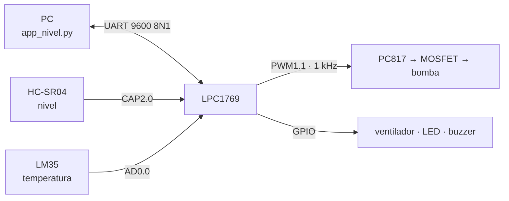

# Control automático de nivel de agua · LPC1769

Trabajo Práctico Integrador de **Electrónica Digital III** (Grupo 7).
Un LPC1769 mantiene el nivel de agua de un tanque de ~2 L en el valor que se fija desde la PC, con un lazo **PI** sobre una bomba, y vigila la temperatura de la placa con una alarma térmica.



## Qué hace

- **Mide el nivel** con un HC-SR04 cada 100 ms (TIMER2 en modo captura, ambos flancos).
- **Regula la bomba** por PWM con un PI sintonizado por λ/SIMC (Kc = 1,51 %/mm, Ti = 120 s, anti-windup).
- **Protege el sistema**: con el nivel en 180 mm o más corta la bomba, y si el sensor deja de responder la apaga.
- **Alarma térmica** con histéresis: a 45 °C enciende el ventilador, el LED y el buzzer, y los apaga a 40 °C.
- **Dos modos**: AUTO (PID) y MANUAL (PWM fijo, para identificar la planta).

## Estructura

| Carpeta | Contenido |
|---|---|
| `Firmware/` | Firmware en C sobre registros CMSIS, en tres capas (aplicación, servicios, dispositivos) |
| `PC/` | `app_nivel.py`: interfaz Tkinter con telemetría, gráficos y registro CSV · `identificar.py`: ajuste de K y τ y cálculo del PI |
| `Proteus/` | Modelo VSM propio del LPC1769 y del HC-SR04 para simular en Proteus, y firmwares de prueba ([guía](Proteus/README.md)) |
| `Anteproyecto_control_nivel_agua.md` | Modelo matemático del tanque y su linealización |

## Uso rápido

**Firmware**: crear un proyecto C para LPC1769 en MCUXpresso con CMSIS, copiar el contenido de `Firmware/` y compilar.

**Aplicación de PC**:

```bash
cd PC
pip install -r requirements.txt
python app_nivel.py
```

**Identificación de la planta**: en modo MANUAL, aplicar un escalón de PWM, registrar hasta que el nivel se estabilice y luego:

```bash
python identificar.py registro_AAAAMMDD_HHMMSS.csv --lambda 30
```

El script imprime las líneas `#define PID_KP` y `PID_KI` listas para pegar en `Control.h`.

## Protocolo UART

Tramas ASCII terminadas en `\n`, a 9600 8N1.

| Sentido | Trama | Significado |
|---|---|---|
| PC → MCU | `SP=<0 \| 30..160>` | Setpoint en mm (modo AUTO); `0` apaga la bomba |
| PC → MCU | `U=<0..100>` | PWM fijo en % (modo MANUAL) |
| MCU → PC | `L=105,SP=120,T=34.5,PWM=42,FAN=0,ALM=0,ERR=0,MODO=A` | Telemetría cada 500 ms |

## Pines (conector J6 de la LPCXpresso)

| Señal | Pin | Periférico |
|---|---|---|
| TRIG / ECHO del HC-SR04 | P0.5 / P0.4 | GPIO / CAP2.0 |
| LM35 | P0.23 | AD0.0 |
| Bomba | P2.0 | PWM1.1 |
| Ventilador · LED · buzzer | P2.2 · P0.22 · P2.3 | GPIO |
| UART TX / RX | P0.2 / P0.3 | UART0 |

La lógica y la potencia (12 V) tienen masas separadas y solo se comunican a través de los optoacopladores PC817.
